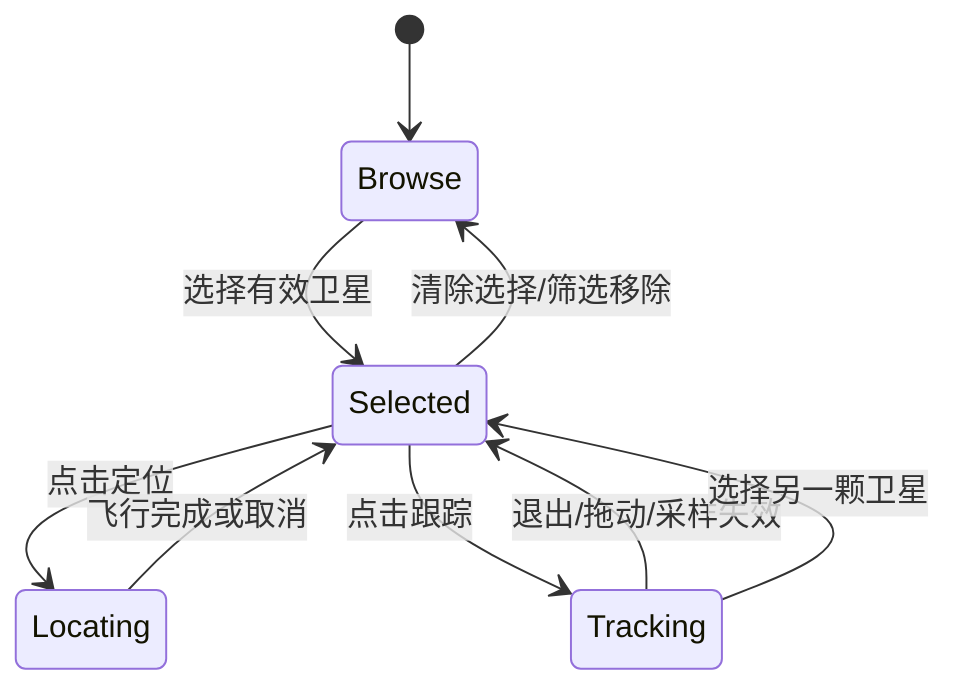
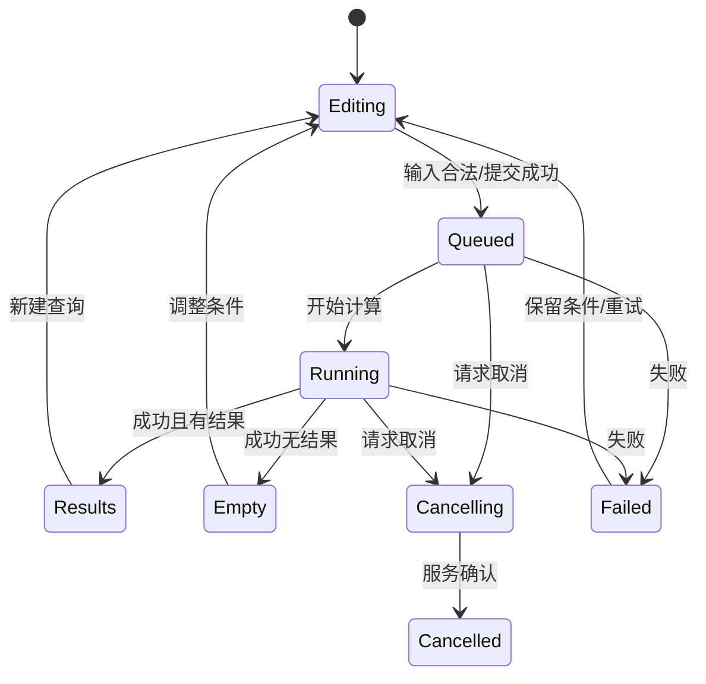

# 星枢 · 交互原型文档

版本 v1.0｜2026-11-11｜形态：文字线框、页面状态、动作契约与流程图，非已运行的点击原型。

依据：[需求文档](./星枢-产品需求文档.md)。组件、尺寸与动画见[详细视觉规范](./视觉与交互规范.md)。

## 1. 原型范围与阅读方法

2026-11-18 远景扩展：探索页“太空”菜单可开关银河，查看地月全景／月球近景／太阳系示意并返回地球；太阳系内点击行星近看。继续拉远可进入太阳系示意，缩近后恢复地球模式；飞行过渡期间锁定当前选择，避免模式闪跳。示意图的距离、尺寸和位置不作星历依据，不改变轨道与预测时钟。公开地图默认使用官方直连及原站缓存，失败后转鉴权长连接回退；交互期间优先连续画面，静止后补细节。详见[验收说明](./地图加速与太空场景验收.md)。

2026-11-15 底图交互补充：探索／观测／站点编辑的“底图”入口支持影像与街道切换，切换图层不重置相机、卫星选择或回放时间。影像允许开关地名；街道自带文字。定位观测站将视角移动至周边约 100 km，可继续缩近并点击地面回填 WGS84 坐标。在线失败时继续显示本地地球或已加载图块，展开底图可查看状态并手动重试；每块自动补试最多一次。关闭站点弹窗释放独立地图。详见[实现与验证](./分级底图与近地浏览.md)。

覆盖登录/注册、卫星探索、观测规划、空间环境、态势大屏、我的空间和管理中心。页面以 P 编号、关键状态以 S 编号、流程以 F 编号定位。设计中的数据均为示意，实际显示必须由接口返回。

每个动作明确触发方式、即时反馈、成功结果、失败及退出方式。可编辑字段、保存动作和删除影响应当可识别，不能只靠视觉效果暗示。

## 2. 页面地图与导航

| 编号 | 页面/路由 | 入口与权限 | 主要出口 |
| --- | --- | --- | --- |
| P00 | 登录 `/login`、注册 `/register` | 未登录入口 | 探索、注册/登录互跳 |
| P01 | 卫星探索 `/explore` | 登录默认入口 | 观测规划、我的空间 |
| P02 | 观测规划 `/observations` | 顶栏、卫星详情、观测站/计划 | 保存计划、回放、我的空间 |
| P03 | 空间环境 `/environment` | 顶栏、大屏天气入口 | 事件详情、来源 |
| P04 | 态势大屏 `/dashboard` | 顶栏 | 全屏退出、探索 |
| P05 | 我的空间 `/workspace` | 顶栏、通知铃铛 | 探索、观测规划、编辑弹窗 |
| P06 | 管理中心 `/admin` | 管理员账号菜单 | 任务与日志详情 |

导航保留各页面必要状态：探索的筛选与选中对象、观测的查询条件与最近任务。卫星/站点/任务等可分享状态进入 URL 参数，不在 URL 放密钥、Token 或私人位置名称。任务深链接仍由后端验证归属。

登录失效后记录站内返回路径，回到登录；登录成功恢复入口。禁止跳转到任意外域 returnTo。管理员入口隐藏不能代替接口鉴权。

## 3. P00 登录与注册

```text
┌─────────────────────────────────────────────────────────────┐
│ 星枢 STAR NEXUS                                             │
│                                                             │
│  装饰性地球/空间背景                欢迎回到星枢             │
│  左下地球，右侧安静留白             用户名 [              ] │
│                                    密码   [           显示] │
│                                    [ 登录              ]   │
│                                    没有账号？注册           │
│  全球卫星态势与观测平台             演示账号说明（本地版）   │
└─────────────────────────────────────────────────────────────┘
```

- 输入具有真实 label；允许密码管理器、粘贴、显示/隐藏密码，Enter 提交。
- S00 默认；S01 校验错误；S02 提交中；S03 账号或密码错误；S04 服务不可用；S05 成功跳转。
- 登录中按钮显示“登录中…”，防重复提交；密码错误不清空用户名，错误信息不泄漏账号是否存在。
- 注册输入用户名、密码、确认密码，强度和长度依据后端规则提示；注册成功后转登录并带回用户名，不默认授予管理员。
- 服务器不可达时提供重试与启动检查提示，不反复弹 Toast。

## 4. P01 卫星探索

2026-11-12 实现补充：正式探索页参考与操作约束见[阶段 3 决策](./阶段3-参考网站与实现决策.md)。首屏代表卫星展示范围单独标注，目录总数不等于绘制点数；时钟超出有效采样不得继续外推。定位、跟踪、拖动解除与全球视角分别提供清楚入口。

### 4.1 线框与信息层级

```text
┌───────────────────── 顶部全局导航 ────────────────────────────┐
│ 卫星目录       │                │ 卫星详情/无选择说明           │
│ 搜索/分组/筛选 │    三维地球    │ 名称、编号、基础参数          │
│ 总数/列表      │  点位与轨道    │ 数据历元/来源/质量            │
│ 选中与关注     │                │ [定位] [跟踪] [关注]          │
│ 分页           │ 地球快捷控制   │ [为此卫星规划观测]            │
│                │                │ 下一次过境（选站后）          │
├──────────────────── 时间/模式/连接/数据状态 ──────────────────┤
└──────────────────────────────────────────────────────────────┘
```

未选择时右栏显示“选择一颗卫星查看轨道与详情”，提供使用引导，不自动展示一颗仿佛已被用户选中的卫星。初始相机以亚洲与太平洋为参考视角，不固定假昼夜。

### 4.2 关键交互契约

| 操作 | 即时反馈 | 成功 | 失败/中断 |
| --- | --- | --- | --- |
| 搜索/筛选 | 控件状态变化，列表局部加载 | 更新 total/list，分页回到 1 | 保留查询，显示重试；旧响应不覆盖新查询 |
| 点击卫星行/点 | 同步选中标记，详情标题更新 | 参数与轨道加载 | 标明部分失败；不把旧对象数据放在新标题下 |
| 定位 | 按钮忙碌、相机开始移动 | 目标进入中央安全区 | 重选取消旧飞行，恢复视角可随时中断 |
| 跟踪 | “正在跟踪：名称”与退出入口 | 相机持续跟随 | 无有效采样暂停跟踪并提示；禁止无限外推 |
| 拖动地球 | 解除相机锁定的轻提示 | 自由浏览、保留选中 | 不取消关注，也不清空详情 |
| 关注 | 按钮局部忙碌 | 已关注、后端持久化 | 恢复原状态、给出重试；不假成功 |
| 规划观测 | 携带卫星参数跳转 | P02 预选卫星和默认站 | 无默认站时引导建站，不凭空添加坐标 |

筛选把当前卫星移出列表时，清除列表选择和对应临时轨道；关注关系保留。也可从我的关注重新打开该卫星。

### 4.3 探索与跟踪状态



选择另一颗卫星先退出旧跟踪，再显示新详情；用户显式点击才跟踪新对象。定位/跟踪状态与网络状态分开管理。

### 4.4 暂停与时间模式

- 默认“当前时刻”：使用系统时间，位置为轨道推算。
- 用户暂停：显示“暂停查看”及冻结时间，网络可以继续接收但不改变显示时刻。
- 用户拖动或改变非 1× 速度：进入“时间推演”，显著显示模拟日期、时区和速度。
- “回到当前”退出模拟，恢复当前系统时间与 1×；不能仅将文字改成实时。
- 探索页默认可拖动范围为当前时刻前后各 90 分钟，属于首版交互建议；超出采样范围先请求对应后端采样，不能用重复旧点补齐。
- 暂停不关闭真实提醒，时间推演不触发模拟未来提醒。

## 5. P02 观测规划

### 5.1 线框

```text
┌───────────────────── 顶部全局导航 ────────────────────────────┐
│ 观测条件          │ 地球/局部地图            │ 过境详情        │
│ 选择/新建观测站   │ 站点与选中轨迹          │ 时间、最高仰角  │
│ 卫星/分组         │                         │ 仰角曲线/窗口   │
│ 24h / 3d / 7d     ├─────────────────────────┤ 判断依据与质量  │
│ 最低仰角          │ 过境结果/任务状态        │ [回放过境]      │
│ [计算过境]        │ 时间/对象/条件/分页      │ [保存计划]      │
├──────────────────── 模拟时间与回放控制 ──────────────────────┤
└──────────────────────────────────────────────────────────────┘
```

### 5.2 建立观测站 F01

1. 点击“新建观测站”打开弹窗，可选择“地图选点”或直接输入。
2. 地图选点进入单独模式：提示“点击地面选点”，显示取消按钮；不同时触发卫星选择。
3. 点击地球表面得到候选点，坐标表单回填；未点击“保存”之前为临时点。
4. 填名称、经纬度、海拔，显示单位与范围；可选设为默认。
5. 提交成功后选中新站点；取消则丢弃临时点，恢复进入前视角与选择。
6. 未保存输入关闭时提示“放弃更改”；成功后关闭不再重复提示。

选点需要地面拾取，点到空间或拾取失败提示“请点击地球表面”，不生成 0,0 站点。键盘可用坐标输入完成全部流程。

### 5.3 预测任务 F02

1. 选站、选单星或分组、时间范围、最低仰角；未满足条件显示字段级提示。
2. 分组超批次上限时先选明确批次，显示对象数与范围；不能提交后悄悄缩减。
3. 点击计算后保存本次查询快照；服务返回 taskId，结果区展示排队/进度，允许取消。
4. 用户可修改表单，但结果区始终展示“本次结果条件”；未重新提交不把旧结果当新查询。
5. 返回结果后默认按开始时间排序，选择第一条可展示事件；没有结果显示条件和“调整条件”。
6. 数据过旧先显示确认弹窗，说明根数时间和影响，用户明确继续才提交带警告查询。



取消仅被服务确认后标记“已取消”；与完成竞争时以服务最终状态为准，不能同时显示已取消与新结果通知。离开页面不自动取消后台任务，返回能查到其状态。

### 5.4 结果详情与回放 F03

- 点击结果行，仅更新事件详情和预览，不立即播放。详情包含日期、时区、完整/跨边界标识、根数版本和计算时间。
- 几何过境与潜在目视窗口分别显示。没有目视窗口时仍可查看几何过境，注明缺少哪项条件。
- 点击“回放过境”进入时间推演；默认从事件前约 60 秒开始，到事件后约 60 秒结束，默认 10×，到结尾自动暂停。
- 回放条显示起止日期、播放/暂停、进度、速度、回到当前；箭头键和可输入时间替代拖动。
- 曲线游标、卫星点位与轨迹共享同一模拟时钟。用户拖动后暂停在选定时刻，点击播放再继续。
- 点击另一条事件先停止旧回放，显示新事件预览；用户再次点击才开始新回放。
- 退出回放回到当前时刻，保留结果与事件选择，不删除计划。

### 5.5 保存计划 F04

1. 点击“保存观测计划”，弹窗展示卫星、站点、起止时间、数据质量与提醒阈值。
2. 默认提前 10 分钟，可选 5/30 分钟；若已错过所选阈值，说明不会补发该阈值提醒，可继续保存计划。
3. 确认后按钮显示保存中；成功显示“已保存”并提供“查看计划”，重复提交返回已有计划或明确提示。
4. 计划开始时间已过时，不创建普通未来计划；提示重新预测，可保留当前结果用于查看。
5. 结果已过期或根数更新时提示复算，不能在后台悄悄换一组时间后保存。

## 6. P03 空间环境

线框：顶部地磁与数据时效概览 → 中部趋势 → 下方可筛选事件表；事件点开右抽屉，包含类别、发生/发布时间、来源和影响说明。

- 筛选保留在 URL 或页面状态，关闭详情返回同一行附近。
- 指标“暂无数据”不显示为 0；过期或失败也不显示“正常”。
- 官方预警、预测与观测用文字标签区分。原文等级保留，科普说明与原始事实分别排版。
- 外链明确显示来源域名，新窗口打开且不丢失筛选上下文。
- 无近期事件显示“所选范围暂无事件”，不生成风险条目填空。

## 7. P04 态势大屏

线框：标题与时钟 → 左统计/中央地球/右统计 → 底部滚动榜单与来源状态。所有图表来自本地聚合接口，范围和未知项可查。

- 进入后提供“全屏展示”“暂停轮播”“返回探索”，全屏申请失败仍可正常使用。
- 浏览器 Escape 退出全屏；页面内也有退出按钮，不强制重新进入。
- 榜单鼠标悬停、键盘聚焦或主动暂停时停止滚动；减少动态效果时默认静态。
- 大屏详情轻操作，点击卫星可定位；复杂筛选和编辑进入工作台，不在展示画布叠多层弹窗。
- 统计过期与连接断开在底部固定显示，不能全屏后隐藏。

## 8. P05 我的空间

| 页内标签 | 主动作 | 其他操作与状态 |
| --- | --- | --- |
| 我的关注 | 前往探索 | 定位、取消关注、规划观测；空态指向搜索 |
| 观测站 | 新建观测站 | 修改、默认、删除；删除说明关联计划保留快照 |
| 观测计划 | 前往规划 | 即将开始/已结束/已取消筛选，详情、回放、取消、重算 |
| 通知 | 全部已读 | 未读筛选、详情、跳转关联计划；无效关联仍能查看通知摘要 |

计划重算先展示新旧时间与依据差异，用户确认后更新计划版本并重排提醒；取消不再投递未来提醒。通知计数更新不抢焦点。

提醒由实际系统时间触发，与正在回放的模拟时间无关。应用关闭不承诺通知；重启后显示错过状态并恢复未来任务，不批量弹出已过时的提醒。

2026-11-15 阶段 7 落地：通知铃铛进入独立 `/notifications`，关联计划进入 `/workspace?plan=…`；该调整让通知列表保持单独的筛选和已读上下文。空间环境事件详情使用居中大弹窗承载源站原文与多种时间，关闭保留 `kind/category/source/days/page` 条件，恢复触发控件焦点。观测趋势与预测分别绘制，来源区显示真实采集历史、过期／未知与上次有效数据回退。完整行为见[阶段 7 报告](./阶段7-站内提醒与空间环境验收.md)。

## 9. P06 管理中心

线框：页内标签“数据源 / 采集任务 / 用户管理” → 筛选工具栏 → 状态/表格 → 详情抽屉。

- 刷新返回任务 ID；采集中按钮禁用并显示已有任务，重复点击不并发创建。
- 日志区分尝试时间、成功时间、失败条数和缓存状态。日志详情提供 requestId，隐藏密钥、连接票据和内部敏感配置。
- 禁用用户需确认，当前唯一管理员不能被禁用；成功与失败都有明确状态。
- 故障演示仅管理员可用，进入前说明影响范围；全局持续显示“故障演示中”，有恢复入口。
- 退出故障演示后执行实际恢复检查，不能直接把来源状态改为正常；故障日志保留。

2026-11-15 阶段 8 落地：独立大屏和管理中心已实现，完整行为见[阶段 8 验收](./阶段8-统计大屏与管理中心验收.md)。大屏默认榜单为最新根数，可切换本人观测站的已保存未来预测，零结果不填示例。管理保留来源／结果／时间／分页与详情上下文；天气批次有子失败时明确标记部分失败。故障演示退出后若实际检查失败，显示“演示已关闭，上次恢复检查部分来源未通过”，仍可再次检查或重新开启演示。

## 10. 全局异常与恢复契约

| 情况 | 界面表现 | 恢复路径 |
| --- | --- | --- |
| HTTP 超时 | 当前区域错误、保留输入与已有结果 | 手动重试，不全页白屏 |
| WS 断开 | “连接断开，重连中”及最后接收时间 | 退避重连、补快照；不丢关注和查询 |
| Token 失效 | 停止受保护请求，提示重新登录 | 登录后返回安全站内入口 |
| 第三方故障 | 使用缓存/库/快照时显示具体来源 | 数据源恢复后更新，不伪造采集时间 |
| 根数过期 | 卫星与结果显示陈旧原因 | 刷新或明确确认后带警告计算 |
| 数据不存在 | “对象暂不可用”而非空白 | 返回列表/换对象 |
| WebGL 不可用 | 清晰说明三维不可用 | 列表、表单、文本结果仍可使用 |
| 保存失败 | 表单与原状态保留 | 修正字段或重试，不显示已保存 |
| 操作无权限 | 当前操作被拒绝，解释所需权限 | 返回可访问页面，不清空其他状态 |

连接、数据质量、时间模式是三个独立维度。例如“连接正常 + 根数陈旧 + 时间推演”允许同时出现，不压缩成单个绿色“实时”。

## 11. 浏览器原型的实现与评审顺序

本文是可执行设计契约；后续可运行原型按以下顺序交付，不把静态图当作实现完成：

1. 登录壳、导航和组件状态；可先使用明确标注的固定样本验证布局。
2. 探索：搜索、选中、定位、跟踪、关注，尽早接真实 API。
3. 观测：建站、提交任务、结果、回放与保存，验证模拟时钟。
4. 其余页面：统一状态与跨页跳转，完成真实持久化与权限。
5. 键盘、减少动态效果、缩放、异常和快速连续操作检查。

评审任务：

| 编号 | 操作 | 通过条件 |
| --- | --- | --- |
| T01 | 登录后搜索 ISS，点击与定位 | 详情正确，相机目标不被面板挡住 |
| T02 | 连续快速定位三颗卫星 | 最后目标生效，没有排队飞行或旧数据 |
| T03 | 跟踪时拖动、退出、恢复全球 | 状态与相机一致，随时可退出 |
| T04 | 只用键盘创建观测站并预测 | 有焦点、校验、取消和返回路径 |
| T05 | 修改条件但不重新提交 | 旧结果仍明确属于旧条件 |
| T06 | 回放并拖动时间轴 | 点位、曲线和时间一致，提醒仍按真实时间 |
| T07 | 保存计划，重启，取消或重算 | 持久化正确、提醒去重、版本可追踪 |
| T08 | 断网与恢复 | 无白屏、来源与时间准确、WS 恢复 |
| T09 | 缩放至 200% 或减少动态效果 | 表单和关键动作可用，无被裁切操作 |
| T10 | 普通用户访问管理路由/API | 权限拒绝，不能靠隐藏菜单绕过 |

尚未执行上述评审；结果在开发后的验收记录中填写。
